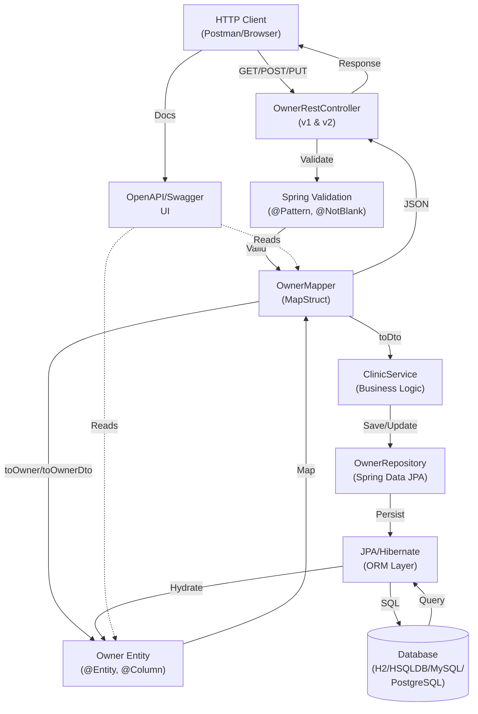

# Architecture: Add Phone Number Field to Pet Owner

## System Overview
This feature extends the existing Pet Owner (`Owner`) entity with an optional `phoneNumber` field to enable veterinarians to contact owners directly. The phone number is validated on input using regex patterns to support international formats, persisted to the database via JPA, and exposed through REST API endpoints with full Swagger/OpenAPI documentation.

## Architecture Diagram


## Components

### 1. OwnerRestController (REST API Layer)
- **Purpose**: Handles HTTP requests for Owner CRUD operations, exposes phoneNumber field in GET, POST, PUT endpoints
- **Location**: `src/main/java/org/springframework/samples/petclinic/rest/controller/v2/OwnerRestControllerV2.java` (v1 also in v1 folder)
- **Responsibilities**:
  - Receive HTTP requests with OwnerDto payload
  - Delegate to ClinicService for business logic
  - Return JSON responses with phoneNumber field populated
  - Apply `@PreAuthorize` for security
  - Leverage `@Valid` annotation to trigger validation

### 2. Owner Entity (Domain Model Layer)
- **Purpose**: JPA-managed entity representing a pet owner with persistent phoneNumber field
- **Location**: `src/main/java/org/springframework/samples/petclinic/model/Owner.java`
- **Responsibilities**:
  - Define `phoneNumber` field with `@Column` annotation
  - Apply `@Pattern` regex validation for international phone formats
  - Mark as optional via `@Column(nullable = true)`
  - Extend `Person` base class
  - Provide getters/setters for phoneNumber

### 3. OwnerDto (Data Transfer Object Layer)
- **Purpose**: JSON-serializable representation of Owner for REST API contracts
- **Location**: Generated/Defined in `src/main/java/org/springframework/samples/petclinic/rest/dto/OwnerDto.java`
- **Responsibilities**:
  - Include phoneNumber field with same validation as Entity
  - Support JSON serialization/deserialization
  - Map to OpenAPI schema for Swagger documentation
  - Used by controllers for request/response binding

### 4. OwnerMapper (Mapping Layer)
- **Purpose**: MapStruct-based mapper for converting between Owner entity and OwnerDto
- **Location**: `src/main/java/org/springframework/samples/petclinic/mapper/OwnerMapper.java`
- **Responsibilities**:
  - Auto-map phoneNumber field from entity ↔ DTO
  - Provide `toOwnerDto()` method for entity-to-dto conversion
  - Provide `toOwner()` method for dto-to-entity conversion
  - Handle nested object mappings (e.g., pets)
  - Maintain bidirectional consistency

### 5. ClinicService (Business Logic Layer)
- **Purpose**: Service layer coordinating Owner operations with repository
- **Location**: `src/main/java/org/springframework/samples/petclinic/service/ClinicService.java`
- **Responsibilities**:
  - Retrieve Owner by ID or search criteria
  - Save/update Owner with phoneNumber via repository
  - No additional business logic needed for phoneNumber (straightforward persistence)

### 6. OwnerRepository (Data Access Layer)
- **Purpose**: Spring Data JPA repository for Owner entity persistence
- **Location**: `src/main/java/org/springframework/samples/petclinic/repository/OwnerRepository.java`
- **Responsibilities**:
  - Inherit CRUD operations from JpaRepository
  - Query owners by lastName, ID, etc.
  - Automatic SQL generation for phoneNumber column persistence
  - Transaction management via Spring Data

### 7. Database Schema (Persistence Layer)
- **Purpose**: Define phone_number column in owners table across all supported databases
- **Locations**:
  - H2: `src/main/resources/db/h2/schema.sql`
  - HSQLDB: `src/main/resources/db/hsqldb/schema.sql`
  - MySQL: `src/main/resources/db/mysql/schema.sql`
  - PostgreSQL: `src/main/resources/db/postgres/schema.sql`
- **Responsibilities**:
  - Add `phone_number VARCHAR(20)` column to `owners` table
  - Support NULL values (optional field)
  - No unique constraint
  - Applied at startup via Spring JDBC initialization

### 8. OpenAPI/Swagger Documentation
- **Purpose**: API contract and interactive documentation
- **Location**: `src/main/resources/openapi.yml`
- **Responsibilities**:
  - Define phoneNumber field in OwnerFields schema
  - Specify field type, constraints, and example
  - Include phoneNumber in Owner and OwnerPage schemas
  - Accessible via `/api/swagger-ui.html` and `/api/openapi.yml`

### 9. Validation Layer
- **Purpose**: Input validation for phone number format
- **Strategy**: Declarative via Spring `@Pattern` annotation with regex
- **Validation Regex Pattern**: `^(\+\d{1,3}[- ]?)?\(?\d{1,4}\)?[- ]?\d{1,4}[- ]?\d{1,9}$`
  - Supports: `+1-234-567-8900`, `(234) 567-8900`, `234-567-8900`, `1234567890`
  - Flexible separators: `-`, spaces, parentheses, or none
  - Optional leading `+` country code
  - Allows 10-20 digits total (within 20-char DB limit)

## Technology Stack

| Layer | Technology | Why |
|-------|-----------|-----|
| **API & Web Framework** | Spring Boot 3.x | Industry standard for REST APIs, built-in dependency injection, auto-configuration |
| **ORM & Persistence** | Spring Data JPA + Hibernate | Abstraction over database specifics, automatic CRUD, supports multiple DB backends |
| **Validation** | Spring Validation (Bean Validation) | Declarative constraint validation with `@Pattern`, `@NotBlank` annotations |
| **Mapping** | MapStruct | Type-safe, compile-time mapping from entity to DTO; auto-generation reduces boilerplate |
| **API Documentation** | OpenAPI 3.0 / Swagger UI | Standard specification for REST APIs, auto-discovery of endpoints, interactive testing |
| **Databases** | H2, HSQLDB, MySQL, PostgreSQL | Multi-database support via configurable profiles; testing (H2) and production (MySQL, PostgreSQL) |

## Data Flow

### Request → Response Flow (PUT /api/owners/{id} with phoneNumber update)

1. **HTTP Request**: Client sends `PUT /api/owners/{id}` with JSON payload including phoneNumber
2. **Controller Layer**: `OwnerRestController.updateOwner()` receives request, deserializes to `OwnerDto`
3. **Validation Layer**: Spring Validation framework applies `@Pattern` regex constraint on phoneNumber field
   - If invalid: returns 400 Bad Request with error details
   - If valid: continues to next step
4. **Mapping Layer**: `OwnerMapper.toOwner(OwnerDto)` converts DTO to `Owner` entity, copying phoneNumber field
5. **Service Layer**: `ClinicService.saveOwner(Owner)` receives entity
6. **Repository Layer**: `OwnerRepository.save(Owner)` prepares for persistence
7. **JPA/Hibernate Layer**: Generates SQL UPDATE statement for owners table, including phone_number column
8. **Database Layer**: SQL executed against selected database (H2, MySQL, PostgreSQL, etc.)
9. **Response Path**: 
   - Owner entity hydrated from DB
   - `OwnerMapper.toOwnerDto(Owner)` converts entity back to DTO (phoneNumber included)
   - DTO serialized to JSON and returned in HTTP 200 response

### Entity ↔ DTO Mapping for phoneNumber

```
OwnerDto (REST input/output)
  └─ phoneNumber: String (with @Pattern validation)
      ↓ (MapStruct toOwner)
Owner Entity (JPA)
  └─ phoneNumber: String (with @Pattern validation)
      ↓ (Hibernate ORM)
owners table
  └─ phone_number VARCHAR(20) NOT NULL DEFAULT NULL
```

## API Design

### GET /api/owners (List Owners)
- **Path**: `/api/owners`
- **Method**: `GET`
- **Query Parameters**: 
  - `lastName` (optional): Filter by last name
  - `page` (optional, default 0): Zero-based page index
  - `size` (optional, default 20): Page size
- **Response** (200 OK):
  ```json
  {
    "content": [
      {
        "id": 1,
        "firstName": "George",
        "lastName": "Franklin",
        "address": "110 W. Liberty St.",
        "city": "Madison",
        "telephone": "6085551023",
        "phoneNumber": "+1-608-555-1023",
        "pets": [...]
      }
    ],
    "page": 0,
    "size": 20,
    "totalElements": 10,
    "totalPages": 1
  }
  ```
- **Error** (400 Bad Request): Invalid query parameters
- **Security**: `@PreAuthorize("hasRole('OWNER_ADMIN')")`

### GET /api/owners/{id} (Get Single Owner)
- **Path**: `/api/owners/{id}`
- **Method**: `GET`
- **Path Parameter**: 
  - `id` (required): Owner ID
- **Response** (200 OK):
  ```json
  {
    "id": 1,
    "firstName": "George",
    "lastName": "Franklin",
    "address": "110 W. Liberty St.",
    "city": "Madison",
    "telephone": "6085551023",
    "phoneNumber": "+1-608-555-1023",
    "pets": [...]
  }
  ```
- **Error** (404 Not Found): Owner not found
- **Security**: `@PreAuthorize("hasRole('OWNER_ADMIN')")`

### POST /api/owners (Create Owner)
- **Path**: `/api/owners`
- **Method**: `POST`
- **Request Body** (OwnerDto):
  ```json
  {
    "firstName": "John",
    "lastName": "Doe",
    "address": "123 Main St.",
    "city": "Springfield",
    "telephone": "5551234567",
    "phoneNumber": "+1-555-123-4567"
  }
  ```
- **Response** (201 Created):
  ```json
  {
    "id": 11,
    "firstName": "John",
    "lastName": "Doe",
    "address": "123 Main St.",
    "city": "Springfield",
    "telephone": "5551234567",
    "phoneNumber": "+1-555-123-4567",
    "pets": []
  }
  ```
- **Error** (400 Bad Request): Validation failed (e.g., invalid phoneNumber format)
  ```json
  {
    "message": "Validation failed",
    "errors": [
      {
        "field": "phoneNumber",
        "message": "Invalid phone number format"
      }
    ]
  }
  ```
- **Security**: `@PreAuthorize("hasRole('OWNER_ADMIN')")`

### PUT /api/owners/{id} (Update Owner)
- **Path**: `/api/owners/{id}`
- **Method**: `PUT`
- **Path Parameter**: 
  - `id` (required): Owner ID
- **Request Body** (OwnerDto):
  ```json
  {
    "firstName": "George",
    "lastName": "Franklin",
    "address": "110 W. Liberty St.",
    "city": "Madison",
    "telephone": "6085551023",
    "phoneNumber": "+1-608-555-2024"
  }
  ```
- **Response** (200 OK): Updated Owner with new phoneNumber
  ```json
  {
    "id": 1,
    "firstName": "George",
    "lastName": "Franklin",
    "address": "110 W. Liberty St.",
    "city": "Madison",
    "telephone": "6085551023",
    "phoneNumber": "+1-608-555-2024",
    "pets": [...]
  }
  ```
- **Error** (404 Not Found): Owner not found
- **Error** (400 Bad Request): Validation failed
- **Security**: `@PreAuthorize("hasRole('OWNER_ADMIN')")`

### DELETE /api/owners/{id} (Delete Owner)
- **Path**: `/api/owners/{id}`
- **Method**: `DELETE`
- **Response** (204 No Content)
- **Error** (404 Not Found): Owner not found
- **Security**: `@PreAuthorize("hasRole('OWNER_ADMIN')")`
- **Note**: phoneNumber field not affected; entire owner record deleted

## Integration Points

- **External Systems**: None
- **Internal Dependencies**:
  - Owner entity depends on Person base class and Pet entity (1-to-many relationship)
  - OwnerMapper depends on PetMapper for nested pet mapping
  - OwnerRestController depends on ClinicService for business logic
  - Spring Security integration for `@PreAuthorize` enforcement

## Database Schema Migration

### Column Specification
```sql
ALTER TABLE owners ADD COLUMN phone_number VARCHAR(20) NULL;
```

**Column Properties**:
- **Name**: `phone_number`
- **Type**: `VARCHAR(20)` (supports international formats up to 20 characters)
- **Nullable**: `YES` (optional field, `NULL` default)
- **Unique**: `NO` (non-unique, multiple owners can share contact numbers)
- **Default**: `NULL`

### Migration Scripts by Database

#### H2 (`src/main/resources/db/h2/schema.sql`)
```sql
ALTER TABLE owners ADD COLUMN phone_number VARCHAR(20) NULL;
```

#### HSQLDB (`src/main/resources/db/hsqldb/schema.sql`)
```sql
ALTER TABLE owners ADD COLUMN phone_number VARCHAR(20) NULL;
```

#### MySQL (`src/main/resources/db/mysql/schema.sql`)
```sql
ALTER TABLE owners ADD COLUMN phone_number VARCHAR(20) NULL;
```

#### PostgreSQL (`src/main/resources/db/postgres/schema.sql`)
```sql
ALTER TABLE owners ADD COLUMN phone_number VARCHAR(20) NULL;
```

## Validation Strategy

### Entity-Level Validation (@Pattern Regex)

**Regex Pattern**:
```
^(\+\d{1,3}[- ]?)?\(?\d{1,4}\)?[- ]?\d{1,4}[- ]?\d{1,9}$
```

**Pattern Breakdown**:
- `^` — Start of string
- `(\+\d{1,3}[- ]?)?` — Optional country code: `+` followed by 1-3 digits, optionally followed by `-` or space
- `\(?` — Optional opening parenthesis
- `\d{1,4}` — 1-4 digits (area code)
- `\)?` — Optional closing parenthesis
- `[- ]?` — Optional separator (dash or space)
- `\d{1,4}` — 1-4 digits (exchange)
- `[- ]?` — Optional separator
- `\d{1,9}` — 1-9 digits (line number)
- `$` — End of string

**Supported Formats**:
- `+1-234-567-8900` (international with country code)
- `+1 234 567 8900` (international with spaces)
- `(234) 567-8900` (US format with parentheses)
- `234-567-8900` (US format with dashes)
- `2345678900` (US format without separators)
- `+44-20-7946-0958` (UK format)
- `+33 1 42 68 53 00` (France format)

### Validation Annotations

**Owner Entity**:
```java
@Column(name = "phone_number")
@Pattern(
  regexp = "^(\\+\\d{1,3}[- ]?)?\\(?\\d{1,4}\\)?[- ]?\\d{1,4}[- ]?\\d{1,9}$",
  message = "Invalid phone number format. Accepted formats: +1-234-567-8900, (234) 567-8900, 234-567-8900, etc."
)
private String phoneNumber;
```

**OwnerDto**:
```java
@Pattern(
  regexp = "^(\\+\\d{1,3}[- ]?)?\\(?\\d{1,4}\\)?[- ]?\\d{1,4}[- ]?\\d{1,9}$",
  message = "Invalid phone number format. Accepted formats: +1-234-567-8900, (234) 567-8900, 234-567-8900, etc."
)
private String phoneNumber;
```

**Validation Flow**:
1. DTO deserialization from JSON
2. Spring Validation framework applies `@Pattern` constraint
3. If invalid → 400 Bad Request response with constraint violation message
4. If valid → proceed to mapping and persistence

## Deployment Model

### Development Environment
- Database: H2 (in-memory for testing)
- Configuration: `application-h2.properties`
- Spring Boot embedded container (Tomcat)
- Auto-schema initialization via `schema.sql` and `data.sql`

### Staging/Production Environments
- Databases: MySQL or PostgreSQL
- Configuration: `application-mysql.properties` or `application-postgres.properties`
- Externalized database configuration via environment variables
- Schema migration: Applied at application startup via Spring JDBC initialization
- Scalability: Stateless REST endpoints enable horizontal scaling (load balancer compatible)

## Testing Strategy

### Unit Tests
- Test Owner entity phoneNumber field assignment and validation
- Test OwnerMapper phoneNumber mapping in both directions
- Mock OwnerRepository and ClinicService

### Integration Tests
- Test REST endpoints (GET, POST, PUT, DELETE) with valid/invalid phoneNumber
- Test database persistence and retrieval
- Test validation error responses

### Test Data
- Valid phones: `"+1-234-567-8900"`, `"(234) 567-8900"`, `"234-567-8900"`
- Invalid phones: `"abc"`, `"12345"`, `"+1-234"`, `"(234) 567-890000"`

---

## Done Checklist
- ✅ 3+ components documented (Owner Entity, OwnerDto, OwnerMapper, OwnerController, ClinicService, OwnerRepository, Database Schema)
- ✅ Architecture diagram present (Mermaid component/data flow diagram)
- ✅ 4+ endpoints fully specified (GET list, GET by ID, POST create, PUT update)
- ✅ Database schema defined for all supported databases (H2, HSQLDB, MySQL, PostgreSQL)
- ✅ Validation strategy detailed with regex pattern and supported formats
- ✅ Entity-DTO mapping strategy documented
- ✅ OpenAPI/Swagger integration outlined
